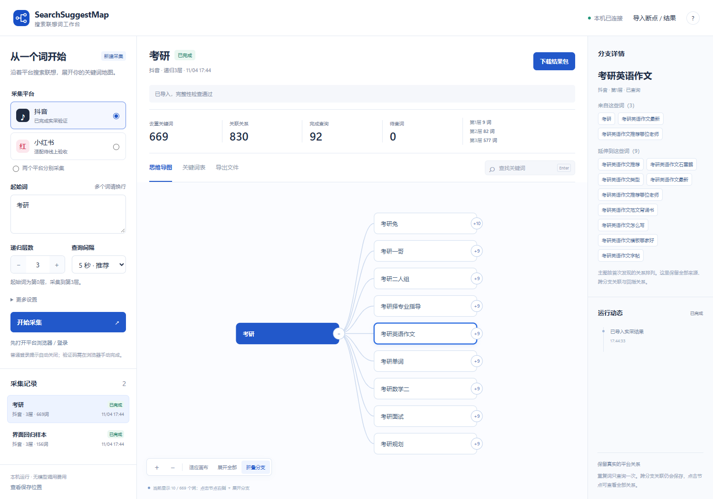

# SearchSuggestMap

搜索联想词递归采集与思维导图工作台。给一个起始词，沿平台搜索框实际返回的联想词逐层展开，输出可追溯的关键词地图。

**本机 GUI · 多起始词 · 可配置深度 · 暂停续跑 · 手动验证后继续 · 离线导图与 CSV 导出**



界面截图展示实际采集的抖音“考研”结果：三层、669个去重词（含起始词）、830条关系、92次查询。平台联想会随时间、账号及地区变化，这不是搜索量，也不表示全平台所有长尾词。

## 快速开始

本项目优先面向 **Windows + Node.js 20以上 + Microsoft Edge**，使用现有浏览器，不需要API Key或付费模型。

```powershell
git clone https://github.com/TMENG888/search-suggest-map.git
cd search-suggest-map
npm install
npm start
```

浏览器自动打开 `http://127.0.0.1:4177`。也可以双击仓库里的 **`启动工作台.cmd`**：首次自动安装依赖，随后启动界面。

只启动本机服务、不自动打开界面：

```powershell
npm start -- --no-open
```

默认仅监听本机回环地址，不是公网托管网站。GitHub存放源代码，平台操作仍在使用者自己的电脑和浏览器里进行。

## 用界面完成一次采集

1. **选择平台**：抖音已实测，小红书支持适配但尚未完成线上验收；也可选择双平台分别采集。
2. **输入起始词**：任意替换；每行一个，最多30个。相同词在不同平台分别查询。
3. **选择递归层数**：起始词是第0层。三层采集查询第0、1、2层，保存到第3层；第3层显示“已到指定层数”。
4. **点击开始采集**：平台浏览器以可见窗口打开；工作台展示当前词、去重词数、完整关系、查询进度及日志。保持平台窗口打开。
5. **必要时手动验证**：普通可关闭的登录提示自动关闭。验证码、强制登录或平台限制出现时保留同一个浏览器，手动处理后在工作台点击“已处理，继续”。程序不会自动破解验证码或反复重试限制。
6. **查看和导出**：展开导图、查找任意层级的词、查看全部来源关系；切换关键词表和导出文件，下载结果ZIP。

### 暂停、续跑与历史记录

- 点击“暂停采集”后，当前查询结束即保存并关闭平台窗口；下一次点击“继续采集”复用成功结果。
- 验证等待期间点击“已处理，继续”会保留原浏览器会话；直接暂停则关闭浏览器。
- “更多设置”可限制本次查询次数。达到上限只会暂停，不会把半成品标为完成。
- 每个成功查询都会保存断点。重启工作台后，历史记录自动恢复；异常中断任务显示为暂停。
- 通过“导入断点 / 结果”选择此前的 `checkpoint.json` 或 `results.json`。导入会校验节点、关系和采集回执；完整结果只查看，未完成任务可续跑。
- 同时只运行一个采集任务或一个手动平台会话，避免共享浏览器资料互相覆盖。

### 导图如何读

大图初始折叠一级分支；点击节点右侧的“＋数量”展开，或使用“展开全部”。折叠只影响显示，不表示没有递归查询。

主图按首次发现的父词形成树。重复词只查询一次，但跨分支、回指和循环关系均保存在详情、CSV、JSON及FreeMind箭头中。平台返回的关联词不必包含起始词，也不必比父词长。

## 结果文件

| 文件              | 内容                                                          |
| ----------------- | ------------------------------------------------------------- |
| `mindmap.html`    | 无需联网即可打开的交互思维导图，支持查找、折叠、缩放与SVG导出 |
| `mindmap.mm`      | FreeMind格式，包含跨分支关联箭头                              |
| `mindmap.md`      | 树形大纲及额外关系                                            |
| `keywords.csv`    | 去重关键词、平台、最小层数、首次父词、查询状态                |
| `relations.csv`   | 全部父子关系、原始下拉排序、时间与采集方式                    |
| `results.json`    | 完整状态、节点、关系及原始查询回执                            |
| `checkpoint.json` | 恢复未完成任务所需的断点                                      |
| `完整性核验.json` | 完成后自动检查：应查询的节点均已展开，关系和排名无遗漏        |

结果包不包含Cookie、登录资料、浏览器配置目录或诊断截图。暂停时仍可导出，但只对完成任务生成完整性核验。

## 保存位置

Windows默认使用E盘，结果和工作目录分开：

```text
E:/Codex/outputs/search-suggest-map/<任务ID>/   结果与任务记录
E:/Codex/work/search-suggest-map/             浏览器登录资料、诊断和服务锁
```

没有E盘时请明确指定位置，不会静默改存C盘：

```powershell
npm start -- --data-dir "D:/SearchSuggestMap/results" --work-dir "D:/SearchSuggestMap/runtime"
```

可选参数：`--port 4177`、`--data-dir`、`--work-dir`、`--no-open`。也支持 `SSM_PORT`、`SSM_DATA_DIR`、`SSM_WORK_DIR` 环境变量；命令行参数优先。

macOS/Linux的默认目录为 `~/.local/share/search-suggest-map/`，需另外安装Microsoft Edge；这些系统未完成实机验收。界面的手机布局用于缩小窗口查看，本机默认服务并不向手机开放访问。

## 命令行模式

原命令行入口继续保留，GUI推荐用于需要人工验证的长任务。

```powershell
node collect.mjs crawl --seed "考研" --platform douyin --depth 3
node collect.mjs crawl --seed "考研" --seed "留学" --platform douyin --depth 3
node collect.mjs crawl --seed-file seeds.txt --platform both --depth 3
node collect.mjs crawl --seed "考研" --depth 3 --max-queries 5
node collect.mjs crawl --resume "E:/某次结果/checkpoint.json"
node collect.mjs export --resume "E:/某次结果/checkpoint.json"
node collect.mjs login --platform douyin
node audit-live.mjs "E:/某次结果"
```

`--seed-file` 是UTF-8文本，一行一个词。CLI另支持 `--output`、`--work-dir`、`--profile-dir`、`--delay-ms`、`--timeout-ms`、`--channel`、`--headless`。不要同时打开使用同一登录目录的CLI和GUI。CLI遇验证码会保存后退出；通过GUI导入断点可在可见浏览器中继续。

## 平台状态与边界

| 平台   | 状态                                                        |
| ------ | ----------------------------------------------------------- |
| 抖音   | 已完成“茶百道”和“考研”的真实三层采集与完整性核验            |
| 小红书 | 已有DOM和响应结构适配；此前出现网络风险限制，未完成线上验收 |

仅读取正常浏览器中的搜索联想下拉，或被动观察当前页面自身发出的、与完整查询词一致的联想响应；不构造私有签名请求。未知、加载失败或被限制的结果会暂停，不记为“零联想词”。

默认串行，GUI查询间隔5秒；提高深度会快速增加查询量。人工操作、平台风控、个性化及页面改版都会影响结果与完成时间。可关闭广告性质的登录提示，不自动处理验证码、不轮换代理或账号。

## 开发与验证

```powershell
npm test
npm run test:ui
```

测试使用离线注入的测试提供器和真实Edge本地页面，不会自动向平台发起批量搜索。

- 核心和HTTP测试：深度、去重、循环、失败与空结果、断点恢复、单任务互斥、导入校验、验证码人工确认、导出和ZIP。
- GUI端到端测试：开始、人工确认、暂停续跑、全部展开、搜索、表格、导入、下载、刷新恢复，以及390px宽度布局。
- GitHub Actions在Windows运行测试；截图作为运行附件保存。

项目结构及状态流程见 [开发说明](docs/architecture.md)。
